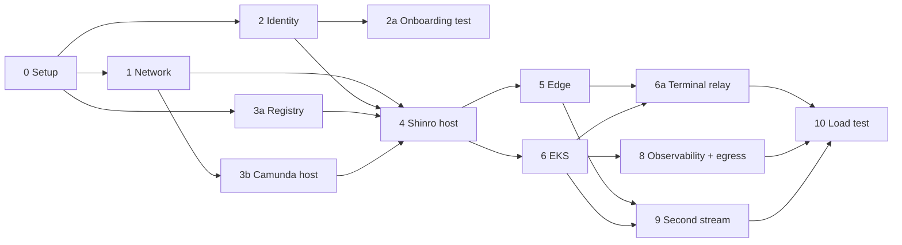

# CDK build steps

Every step to build the Shinro live demo infrastructure, in order, with what can run **at the same time**.

**Source:** [`PLAN.md`](PLAN.md) §3.3–3.4 (stacks and build order). Step numbers match the plan's build order, so "step 6" means the same thing in both. Concepts are explained in [`PLAN-v2.md`](PLAN-v2.md); the Camunda runbook is [`CAMUNDA-DEPLOYMENT.md`](CAMUNDA-DEPLOYMENT.md).

## How deployment works

- **Deploy one step at a time, not everything at the end.** Each step is deployed and its **Check** must pass before anything that depends on it starts.
- For every step: write the stack and unit tests → `cdk synth` + tests → `cdk diff` (read it for **"replacement"** — a replaced EC2 loses its data) → `cdk deploy` → run the check.
- **"Simultaneous" means independent:** steps in the same wave have no dependency on each other, so they can be built and deployed in parallel. Code for a later wave can always be *written* early; only *deploying* waits.
- *(manual)* marks work outside CDK. *(app)* marks work owned by the app team.

## Overview

| Wave | Steps | Run simultaneously | Waits on |
|---|---|---|---|
| **A** | 0 Setup | **1** | — |
| **B** | 1 NetworkStack · 2 IdentityStack · 3a RegistryStack | **3** | A |
| **C** | 2a Onboarding test · 3b CamundaHostStack | **2** | 2a ← 2 + SES production access · 3b ← 1 |
| **D** | 4 ShinroHostStack | **1** | 1, 2, 3a, 3b |
| **E** | 5 EdgeStack · 6 EksStack | **2** | 4 |
| **F** | 6a Terminal relay · 8 ObservabilityStack + egress lock-down | **2** | 5, 6 |
| **G** | 9 Second stream | **1** | 5, 6 |
| **H** | 10 Load test | **1** | everything |

**12 steps in 8 waves.** Step 7 (BuildStack) was dropped (decision 4.18).



**Critical path:** 0 → 1 → 3b → 4 → 6 → 6a → 10. The SES production-access request (about a day) and the app team's session controller are the outside waits most likely to hold it up. Start them early.

---

## Wave A: setup (1 step)

### Step 0: Project setup
**Depends on:** nothing

- [x] Replace the `cdk init` scaffold: `bin/cdk-scaffold.ts` → `bin/shinro-live-infra.ts`; remove `CdkScaffoldStack`; rename the package.
- [x] Pin the region to **us-east-1** and throw in `bin/` on any other region (5.14).
- [x] Apply a `Project` tag and `live` naming everywhere: stacks `ShinroLive*`, SSM `/shinro/live/…`, ECR `shinro-live-*` (5.13).
- [x] Add the stream list to `cdk.json`:
  ```jsonc
  "shinro:streams": [
    { "name": "temporal",
      "subdomain": "temporal.shinro.ai",
      "consoles": ["camunda-demo.shinro.ai", "demo-temporal-ui.shinro.ai"] }
  ]
  ```
- [x] Create the layout: `lib/stacks/`, `lib/constructs/stream-identity.ts`, `assets/shinro-bundle/`, `assets/camunda-bundle/`, `k8s/session-template/`, `scripts/add-demo-user.sh`.
- [x] Put the shared settings in **one** config object: Camunda ports (4.16), instance sizes, TTLs.
- [ ] `cdk bootstrap` the account in us-east-1.
- [ ] *(manual)* Agree that the one new demo pool overrides T-13 (4.2). Pick where the Go module proxy will run (4.17).
- [ ] *(app)* App-side Phase 1 started: demo login, LLM key and limits, EKS `SessionController`, hosting changes, PR #395.

**Check:** `cdk synth` succeeds with empty stacks; tests run.

---

## Wave B: foundations (3 steps at once)

These three stacks don't depend on each other.

### Step 1: NetworkStack (T-10, T-31)
**Status:** deployed 2026-11-10 as `ShinroLiveNetwork` (`vpc-0ede2c73f20528e80`). The NAT reuses the existing Elastic IP `3.212.142.142`; the account is at its Elastic IP limit.
**Changed and redeployed 2026-11-10:** `ShinroInternalSg` removed; sandboxes reach the API publicly.

**Depends on:** 0

- [x] VPC: 2 AZs, public + `PRIVATE_WITH_EGRESS` subnets, `natGateways: 1`. (`10.60.0.0/16`)
- [x] Optional VPC endpoints: S3 gateway (free). ECR and SSM interface endpoints not added yet (cost).
- [x] Security groups (plus `shinroHostSg`, the Shinro EC2's identity group that the others allow from):

| SG | Port(s) | From |
|---|---|---|
| `ShinroCfSg` | 80 | CloudFront origin-facing prefix list only (own SG, 5.5) |
| `ShinroPublicSg` | 443, 80 | anywhere |
| `CamundaSg` | 8080, 26500, 18080 | Shinro SG only |
| EKS node SG | 30000–32767 | Shinro SG only |
| `ShinroInternalSg` | internal CLI listener (e.g. 8000) | EKS node SG only |
| EKS cluster SG | 443 | Shinro SG only |

- [x] Publish VPC, subnet and SG ids to SSM so other stacks read them by name. This avoids hard CloudFormation exports.

**Check:** a test instance in a private subnet reaches the internet through the NAT.

### Step 2: IdentityStack (T-13, superseded in part)
**Status:** written 2026-11-10 as `ShinroLiveIdentity`, not deployed. New pool agreed: the old `shinro-demo` pool is left alone (T-13 overridden).

**Changes from the plan:**
- `shinro.ai` DNS is at Cloudflare, so CDK can't write the DKIM records. The deploy prints 3 DKIM CNAMEs and a DMARC TXT to add by hand ("DNS only").
- Two deploys. Cognito won't accept the SES sender until SES has verified `shinro.ai`. First deploy: pool, groups, clients, SES identity; sign-in is password-only (nobody has one). Then add the DNS records, wait for "verified", set `"shinro:sesDomainVerified": true` in `cdk.json` and deploy again. That turns on email codes in place; the pool is not replaced.
- Client secrets stay in Cognito; the Shinro host reads them at boot with `DescribeUserPoolClient`.

**Depends on:** 0 (imports the `shinro.ai` hosted zone for DKIM)

Once:
- [x] Pool **`shinro-live-demo`**: `featurePlan: ESSENTIALS`, `signInPolicy.allowedFirstAuthFactors: emailOtp`, `UserPoolEmail.withSES(...)`, self-sign-up off, **`RemovalPolicy.RETAIN`** (5.12).
- [x] One Managed Login domain `shinro-live-demo-<account>` (`NEWER_MANAGED_LOGIN`) + `CfnManagedLoginBranding` (logo; "the code expires in a few minutes").
- [x] SES `EmailIdentity` for `shinro.ai` with Easy DKIM. Records go to **Cloudflare by hand** (printed as outputs), plus DMARC. No SPF record needed: SES's default MAIL FROM passes SPF itself.
- [x] IAM role `shinro-live-user-admin`, scoped to this pool: create, add/remove group, list groups, set password, disable/enable, global sign-out, delete, get, list.

Looped over `shinro:streams`:
- [x] `CfnUserPoolGroup` named after the stream.
- [x] App client `oauth2-proxy-<stream>`: auth-code flow, `openid email profile`, `generateSecret`, `ALLOW_USER_AUTH`. Build the callback and logout URLs from `subdomain` plus every `consoles` entry (5.23). **Never rename the construct ID** (5.11).
- [x] Cookie secret in Secrets Manager. Client secret read from Cognito at boot instead (see above).
- [x] SSM: pool id, issuer URL, login URL, and each stream's client id, group name and cookie secret ARN.

Not built: a Cognito `camunda` resource server or `camunda-assessment` client. Camunda uses Keycloak (4.20).

- [ ] *(manual)* **Request SES production access right after deploying.** It takes about a day and blocks step 2a.

**Check:** a test user (on a verified address while SES is still in sandbox) gets an OTP email and signs in on the Managed Login page.

### Step 3a: RegistryStack (T-31)
**Status:** deployed 2026-11-10 as `ShinroLiveRegistry`. **CI/CD parked 2026-11-10** (no permission yet to set the GitHub Actions variable). CI role `shinro-live-github-release` added in code (not yet deployed): only pushes to `Quest1Codes/shinro@camunda-demo-graph-deployment-main` can assume it. Pipeline: `.github/workflows/live-release-main.yml` in the app repo.

**Depends on:** 0

- [x] ECR repos: `shinro-live-api`, `shinro-live-tool-exec`, `shinro-live-temporal`, `shinro-live-terminal`. Scan on push.
- [x] CI role `shinro-live-github-release` (GitHub OIDC, existing provider imported). Can push images, write `/shinro/live/release/*`, and run `AWS-RunShellScript` on instances tagged `shinro-live:role=shinro-host`. Cannot deploy CloudFormation.
- [x] *(app)* Workflow `live-release-main.yml`: static analysis → build amd64 by SHA → Trivy → push → record release in SSM → roll the host.
- [ ] *(app)* Images tagged by **commit SHA** and built for **`linux/amd64`**. The terminal image includes a pre-populated Go module cache.

**Check:** CI can push an amd64 image by SHA; scan results appear.

---

## Wave C: first proofs (2 steps at once)

### Step 2a: Onboarding runbook test
**Depends on:** 2, SES production access granted

- [ ] *(manual)* Write `scripts/add-demo-user.sh <stream> <email>`: idempotent, lower-cases and trims the email, rejects unknown streams.
- [ ] *(manual)* Add a test email: create user (`email_verified=true`, `--message-action SUPPRESS`) and add to the `temporal` group.
- [ ] *(manual)* If OTP fails from `FORCE_CHANGE_PASSWORD`, add a `--permanent` random password step (5.15).

**Check:** the code arrives and login works; after `admin-disable-user` it doesn't.

### Step 3b: CamundaHostStack (T-10, T-11, T-12, T-14, T-15, T-16, T-19, T-20)
**Status:** deployed 2026-11-10 as `ShinroLiveCamundaHost` (`i-05742429429d6e48c`); first boot took about 7 minutes. Checked over SSM the same day:
- All six services up and healthy; Keycloak serves the realm; Camunda answers 401 without a token.
- `shinro-assessment` token: `aud` includes `orchestration-api`, `iss` is the public URL. It can read.
- The OMS app deployed `order-processing` v1 itself (T-15 seeded).
- Roles: `readonly-admin` exists in 8.8. `admin` = `orchestration`, `oms-app`; `readonly-admin` = user `demo`, client `shinro-assessment`.
- **Still to prove:** an actual write as `demo` / `shinro-assessment` gets 403 (a cancel of a missing instance returns 404 before the permission check, so it proves nothing).

Earlier note: Bundle in `assets/camunda-bundle/` from `camunda-distributions@cd44d741` (Camunda 8.8.32). Apply bundle edits with `/opt/camunda/bin/update.sh` over SSM; the server is not replaced.

**Depends on:** 1. Full runbook: [`CAMUNDA-DEPLOYMENT.md`](CAMUNDA-DEPLOYMENT.md)

- [x] EC2 `m7i.xlarge` in a private subnet, **no public IP**, `CamundaSg`, SSM role, IMDSv2, encrypted gp3 100 GiB, no SSH.
- [x] **Minimal UserData** (5.3): install Docker, `s3 sync` the bundle, `render-env.sh`, `compose up`. Everything else lives in `assets/camunda-bundle/`.
- [x] Bundle: Compose trimmed to `orchestration`, `elasticsearch`, `identity`, `keycloak`, `postgres`, OMS app.
- [x] Config: `forward-headers-strategy: native`, public hostnames for redirects, `KC_HOSTNAME=https://camunda-demo.shinro.ai/auth`, `KC_PROXY_HEADERS=xforwarded`, `orchestration` client `root-url`.
- [x] Clients and roles: `demo` user **read-only** and removed from `admin`; `shinro-assessment` (read-only, audience `orchestration-api`); `oms-app` (write). **Deviation:** `oms-app` is in Camunda's `admin` role for now (it deploys the BPMN); narrow it once the 8.8 role set is confirmed. `demo` and `shinro-assessment` use `readonly-admin`, which is unverified (release blocker).
- [x] Generate every secret (Keycloak admin, client secrets) into Secrets Manager: six under `shinro-live/camunda/*`.
- [x] DLM policy: daily snapshots, keep 7, covering Elasticsearch **and** Keycloak's Postgres (both on the one root disk).
- [x] CloudWatch agent (memory, disk) and one log group per service. **Moved to step 8:** the alarms and the health-check Lambda.
- [x] Publish the private IP to `/shinro/live/camunda-private-ip`.
- [x] Seed the **OMS BPMN only** (T-15): the OMS app deploys `order-processing.bpmn` itself on startup, as `oms-app`. No manual step.

**Check:**
- Camunda starts privately on 8080 and 26500.
- A `shinro-assessment` token is accepted and its `aud` includes `orchestration-api`.
- **`demo` gets 403 on deploy, cancel and modify.** This is a release blocker (4.11).

---

## Wave D: the front door (1 step)

### Step 4: ShinroHostStack (T-12, T-18)

**Decided 2026-11-10:** both consoles stay (`camunda-demo`, `demo-temporal-ui`); nginx proxies the UI from a private S3 bucket. Images pushed by hand at commit `c6ce73da` (scripts/push-images.sh).

**Open with the backend team (found in the app at `c6ce73da`):**
1. **The API does its own Cognito login** (`core/oauth/cognito.py`, callback `/v2/oauth/callback`). So the demo pool needs a second app client for the API, and oauth2-proxy guards only the two consoles, which have no login of their own. The API's `COGNITO_*` settings point at `shinro-live-demo`.
2. **Group name.** The API maps the Cognito group `demo-users` to its Demo role (`core/rbac.py`); the pool's group is named after the stream (`temporal`). Either the API maps each stream's group to Demo, or the group is renamed. Mapping keeps one group per stream (decision 4.2).
3. **How the API authenticates to EKS.** It loads a kubeconfig (`DEMO_KUBECONFIG`). An EKS kubeconfig normally runs `aws eks get-token`, but the API image has no AWS CLI. Options: the API builds the EKS token itself with boto3 (small app change, uses the instance role; recommended), or a Kubernetes service-account token kept in Secrets Manager.
4. **Which Temporal UI belongs to this user.** The API has no lookup yet. nginx is built against this contract: `GET /v2/demo/temporal-ui/route` with `X-Auth-Request-Email` and `X-Original-URI` → `200` + `X-Accel-Redirect: /_temporal/<node-ip>/<nodeport><uri>`, or `404` with a "start a migration" page. The session template must also expose Temporal's UI (8233) on a NodePort. nginx only follows redirects to this VPC's addresses and NodePorts.

**Status:** deployed 2026-11-10 as `ShinroLiveShinroHost` (`i-0577669028065dad8`, `54.147.229.249`). All five containers up. Checked on the host: `:80` without the origin header → 403, `/docs` → 404, `/v2/*` reaches the API, the Camunda console redirects to sign-in, self-signed certificate until the Cloudflare token exists. The demo catalog finds 1 source (Camunda) and 1 target (Temporal). Fixed after the first boot: nginx `map_hash_bucket_size` for the 48-character origin secret, the API's `SEMANTIC_CACHE_REDIS_URL` (defaulted to `redis-stack`), and the missing `DEMO_TEMPORAL_ADDRESS`. The API logs `No such file or directory: 'aws'` when it reaches for EKS: open item 3 below.

Earlier note: Bundle in `assets/shinro-bundle/`; `bin/render.py` renders every env file and nginx block at boot, tested with a fake AWS CLI and validated by real nginx 1.30.6. Deploy order: `ShinroLiveIdentity` (adds the API's client) → `ShinroLiveShinroHost` → `ShinroLiveEks` (its access entry names the host's role).

**By hand, around the deploy:**
- Secret `shinro-live/cloudflare/dns-api-token`: a Cloudflare token limited to Zone > DNS > Edit on shinro.ai. Until it exists the consoles use a self-signed certificate.
- Cloudflare A records, DNS only: `camunda-demo` and `demo-temporal-ui` → `54.147.229.249`.
- Secrets `shinro-live/shinro/api-env` and `shinro-live/shinro/tool-exec-env`: the app team puts a JSON object of extra settings there (LLM keys and the rest).
- Upload each stream's UI build to `s3://shinro-live-ui-<account>/<stream>/` (built with that stream's `VITE_API_URL`).


**Release contract** (the pipeline from step 3a relies on these):
- [x] Tag the instance `shinro-live:role=shinro-host`; SSM agent running.
- [x] Instance role may read `/shinro/live/release/*` and pull from the `shinro-live-*` repos.
- [x] Install `/opt/shinro-live/bin/roll.sh <service>...`: read `<service>-image` from `/shinro/live/release`, pull by digest, recreate only those Compose services. On first boot, start from the same parameters.
- [x] Attach the existing Elastic IP `54.147.229.249` (`EXISTING_EIPS.shinroHost`); disassociate it from `octavarium-tunnel-aws` first.
**Depends on:** 1 (VPC, SGs), 2 (proxy client ids and secrets), 3a (images), 3b (Camunda private IP)

- [x] **EIP allocated separately, associated last** (5.4): the existing one, associated last.
- [x] EC2 in a public subnet: `ShinroHostSg` + `ShinroCfSg` + `ShinroPublicSg` (no internal group any more), IMDSv2 with hop limit 2 (the API container uses the role), SSM, encrypted gp3.
- [x] Minimal UserData; everything else in `assets/shinro-bundle/`:
  - Compose: nginx (serving the built UI), **one oauth2-proxy per stream**, shinro-api, Redis on a **named EBS volume** (5.29), tool-exec.
  - Templates rendered **per stream** at boot from the SSM stream list: nginx config, oauth2-proxy config (`--allowed-group`, `--cookie-name=_shinro_<stream>`, `.shinro.ai` cookie, 8 h expiry).
  - nginx: origin-secret check on :80; 443 blocks for both consoles; `/auth/*` → Keycloak 18080; session lookup by email (4.7); internal CLI-only listener; strip and re-set `X-Auth-Request-*` everywhere (5.7); WebSocket headers; long timeouts on `/v2/demo/terminal`.
  - certbot + `certbot-dns-route53` for `*.shinro.ai`; alarm on expiry (4.5).
- [x] Role: read `/shinro/live/*` and named secrets, ECR pull, `eks:DescribeCluster`, `DescribeUserPoolClient`. certbot uses a Cloudflare token instead of Route 53.
- [x] nginx: 404 for `/docs`, `/redoc`, `/openapi.json` on every listener (backend requirement, 2026-11-10).
- [ ] Runtime config in SSM / Secrets Manager (PLAN §3.5): `FRONTEND_URL`, the `DEMO_CAMUNDA_*` values, `DEMO_TEMPORAL_UI_URL`, `DEMO_SESSION_TTL_HOURS=48`, `DEMO_SESSION_MAX_ACTIVE=20`, LLM keys.
- [ ] *(manual)* Temporary A record for `camunda-demo` if step 5 isn't deployed yet. Remove it once EdgeStack manages it.

**Check:** `camunda-demo.shinro.ai` → Cognito login → Keycloak `demo` login → Operate, end to end.

---

## Wave E: public edge and sessions (2 steps at once)

Both depend only on step 4 (EdgeStack needs the EIP; EKS needs the Shinro role for its access entry).

### Step 5: EdgeStack
**Status:** deployed 2026-11-11 as `ShinroLiveEdge` (`d2rv7boj8gwvuc.cloudfront.net`). Checked through CloudFront with `temporal.shinro.ai` pinned to it: `/v2/*` reaches the API (origin secret accepted); http → https; a test file in the UI bucket served through `/assets/` (200) and refused when read directly (403), then removed; the server refuses :80 without the secret (403). `/` and the UI paths return 403 until the public page and the UI build are uploaded. **Cloudflare CNAME `temporal` → `d2rv7boj8gwvuc.cloudfront.net` not added yet.**

**Changes from the plan (shinro.ai's DNS is at Cloudflare):**
- No Route 53 and no new certificate: the existing issued `shinro.ai` + `*.shinro.ai` certificate is reused.
- Aliases are the stream pages only (`temporal.shinro.ai`), not `shinro.ai` or `*.shinro.ai`: the apex and `demo.shinro.ai` belong to other things, and each stream needs a Cloudflare record anyway. Adding a stream: config + deploy + one Cloudflare CNAME.
- No `/oauth2/*` behaviour: the app signs users in itself under `/v2/oauth/*`; oauth2-proxy guards only the consoles, which don't use CloudFront.
- Origin: the Shinro EC2's fixed public name on :80, with `X-Shinro-Origin` resolved from Secrets Manager at deploy.
- `/assets/*` cache is keyed by `Host`, since each stream has its own UI build.

**By hand after deploying:** Cloudflare CNAME `temporal` → the distribution's domain (printed), DNS only. Upload the public page to `s3://shinro-live-site-<account>/temporal.shinro.ai/index.html`; until then `/` returns 403.

**Depends on:** 4

- [ ] *(manual)* **List existing `shinro.ai` records first** so the wildcard doesn't hijack one (e.g. `demo.shinro.ai` from the old stack).
- [x] ~~Import the hosted zone~~: no Route 53 (Cloudflare).
- [x] ACM cert for `shinro.ai` + `*.shinro.ai` in us-east-1: the existing one.
- [x] Private S3 bucket + OAC, one folder per hostname. Public pages must not use `/assets/`.
- [ ] One distribution, aliases `shinro.ai` + `*.shinro.ai`:

| Path | Origin | Cache |
|---|---|---|
| `/chat/*`, `/v2/*`, `/oauth2/*`, `/login`, `/settings` | Shinro EC2 | **disabled**, forward everything, WebSocket |
| `/assets/*` | Shinro EC2 | cached |
| default | S3 (host→folder CloudFront Function) | cached |

- [x] Origin-secret header added by CloudFront.
- [ ] Route 53: aliases `shinro.ai` and `*.shinro.ai` → CloudFront; **A records** `camunda-demo` and `demo-temporal-ui` → EIP.

**Check:**
- `temporal.shinro.ai` serves the public page.
- `/oauth2/start` logs in.
- `/chat` and `/v2` reach the app.
- `curl -I` shows no caching on app paths (5.22), tested with two browsers.

### Step 6: EksStack (T-28, T-29, T-30, T-31, T-32)
**Status:** deployed 2026-11-11 as `ShinroLiveEks` (cluster `shinro-live`, Kubernetes 1.36, public endpoint off). Checked the same day:
- Node groups ACTIVE: system 1 × t3.medium (no taint); sandbox 2 × m7i.large (taint `shinro.ai/sandbox`). IMDS hop limit 1 on all nodes.
- Add-ons ACTIVE: `vpc-cni` v1.22.4 with `enableNetworkPolicy: "true"`, `kube-proxy`, `coredns`.
- From the Shinro EC2 as `shinro:session-controller` (server-side dry-run, nothing created): may create namespaces, deployments and network policies; may not read secrets, exec into pods, bind cluster roles or list nodes. The fence allows `demo-<hex>` namespaces with the restricted label and denies a namespace without it, a namespace not named `demo-<hex>`, a deployment in `kube-system`, and deleting `coredns` or `kube-system`.
- **Real session, 2026-11-11** (started through the API's own controller on release `43733e35`, then deleted by it):
  - Ready with all endpoints; both pods on sandbox nodes with the sandbox toleration; NodePorts for terminal and Temporal UI created. The Shinro EC2 reaches the terminal (200).
  - From inside the session, under its NetworkPolicies: public HTTPS reachable (Go proxy, Maven Central); metadata service, the Shinro EC2's private address, Camunda, the Kubernetes API and another session's Temporal all blocked. A namespace with no policies could still reach the metadata service (401, no credentials: hop limit 1) and the Shinro EC2 on :80 (403), which shows the session's own policies are doing the blocking.
  - **Fixed:** the ClusterRole lacked `get deployments/status` (the API's readiness check), which stopped every session from starting.
  - **Strict mode (deployed 2026-11-11):** `vpc-cni` `NETWORK_POLICY_ENFORCING_MODE=strict`, so a new pod starts with everything denied until its policies attach. `kube-system` and `amazon-cloudwatch` get an allow-all policy (applied before strict mode) so CoreDNS and the monitoring agent work as before.
  - **Strict-mode isolation test, no delay (2026-11-11):** a brand-new probe pod in a session reaches public HTTPS (so DNS works) and is blocked from the metadata service, the Shinro EC2, Camunda, the Kubernetes API and another session from its first second. A pod in a namespace with no policies is now blocked from everything. The Shinro EC2 still reaches the terminal (200).
  - **First attempt rolled back (2026-11-11):** strict mode was applied before the `amazon-cloudwatch` namespace had its allow-all policy, so the add-on's pods were blocked and it stayed in CREATING; the update was cancelled. Fixed: that namespace and its policy are now created before the add-on.
  - **Container Insights (deployed 2026-11-11; metrics arriving: 3 nodes, 0 failed):** `amazon-cloudwatch-observability` add-on, metrics only (container logs off, Application Signals off), AWS access through EKS Pod Identity (`eks-pod-identity-agent`, role `shinro-live-eks-cloudwatch-agent`). Alarms in the Observability stack: nodes missing (< 3), node NotReady, average memory > 75%, average disk > 70%.

Earlier note: Kubernetes 1.36, `aws-eks-v2`, node groups (not Auto Mode). The Shinro EC2's access entry (its role → group `shinro:session-controller`) is created in step 4, since the role doesn't exist yet.

**App changes this needs in `apps/api/etc/demo/session.yaml.tmpl`:**
- Toleration `shinro.ai/sandbox=true:NoSchedule` and nodeSelector `shinro.ai/pool: sandbox` on both Deployments.
- Drop the `shinro-api` Service + Endpoints (private IP); set `SHINRO_API_URL` to the public address, e.g. `https://temporal.shinro.ai/v2`.
- NetworkPolicy egress: DNS, own Temporal, TCP 443 to `0.0.0.0/0` except `10.60.0.0/16` and `169.254.169.254/32`.
- Namespaces stay `demo-<hex>` with `pod-security.kubernetes.io/enforce: restricted`: an admission policy refuses anything else from the session controller.

**Backend requirements (2026-11-10), must hold at deployment:**
- [x] **Network-policy enforcement on.** `vpc-cni` add-on with `enableNetworkPolicy: "true"`; without it every NetworkPolicy is silently ignored. Prove it after deploy: a pod in one session namespace can't reach another.
- [x] **Sandbox pods isolated from everything else.** They run LLM-generated code. Two node groups: a small `system` group (CoreDNS, add-ons) and a `sandbox` group with a taint (`shinro.ai/sandbox=true:NoSchedule`) and label; the session template adds the matching toleration and nodeSelector. On sandbox nodes: IMDSv2 with **hop limit 1** (pods can't reach the node's IAM role), a node role with only ECR pull + CNI, no SSH. gVisor is not supported on EKS managed node groups without a custom AMI; revisit only if the separate group isn't enough.
- [x] **EKS API endpoint private only.** kubectl runs from inside the VPC (the Shinro EC2 over SSM). No public endpoint, not even IP-restricted.
- [x] **Sandbox reaches the Shinro API through its public address** (`https://<stream>.shinro.ai/v2/...`, via NAT and CloudFront), not a private listener. This **replaces** the internal CLI listener: drop the `eks-node → shinro-internal :8000` rule and `ShinroInternalSg`. Session NetworkPolicy egress: DNS, its own Temporal, and TCP 443 to `0.0.0.0/0` **except** `10.60.0.0/16` (the VPC) and `169.254.169.254/32` (metadata). Open question for backend: does the sandbox need any other internet access (Go modules)? If not, narrow further.
- [ ] *(app + step 4)* **`/docs` off in production.** App: FastAPI `docs_url`, `redoc_url`, `openapi_url` = `None`. Step 4 nginx also returns 404 for `/docs`, `/redoc`, `/openapi.json` as a backstop.
**Depends on:** 4 (the Shinro role for the access entry)

- [x] Cluster with a **private** endpoint; `aws-eks` + kubectl layer, or `aws-eks-v2-alpha` (5.10). Pin versions.
- [x] Managed node groups: `system` (1× `t3.medium`) and tainted `sandbox` (`m7i.large`, 1–5, starts at 2; raise for 20 sessions after the load test). **`singleProcessOOMKill`** in the sandbox launch template (5.30). No cluster autoscaler yet: scale by changing `EKS.sandboxNodes`.
- [x] Add-ons: `vpc-cni` (`enableNetworkPolicy: "true"`), `coredns`, `kube-proxy`. CloudWatch Observability left for step 8.
- [x] ClusterRole `shinro:session-controller`: namespaces, services, endpoints, quotas, limit ranges, deployments, network policies; read pods. **Not cluster-admin.** Plus a ValidatingAdmissionPolicy fencing its writes to `demo-<hex>` namespaces. The access entry itself is created in step 4.
- [ ] *(app)* `k8s/session-template/`: namespace, ResourceQuota, LimitRange (including `ephemeral-storage`), default-deny NetworkPolicy, Temporal dev server + NodePort (8233, 7233), terminal container with a writable `emptyDir` and T-32 securityContext. The session controller creates these at runtime; **CDK doesn't.**

**Check:**
- Two users open the same `demo-temporal-ui.shinro.ai` and each see **their own** session.
- A hand-set `X-Auth-Request-Email` changes nothing (5.20).
- After the TTL, the page shows "start a migration".
- A session can't reach another session, the Kubernetes API or the metadata service.

---

## Wave F: terminal and hardening (2 steps at once)

### Step 6a: Terminal relay
**Depends on:** 5, 6. Mostly app work. **Changed 2026-11-10:** terminal pods call the API through its public address; there is no internal listener (see step 6).

- [ ] *(app)* Terminal container in the template; `/v2/demo/terminal` relay; one-time code → CLI token.
- [ ] Confirm the CloudFront and nginx idle timeouts hold a quiet terminal (5.27).

**Check:**
- "Run in terminal" opens **your** sandbox, and a refresh reattaches.
- The one-time code can't be replayed.
- `go build` works.
- A pod reaches the CLI routes and nothing else.

### Step 8: ObservabilityStack + egress lock-down (T-19, T-20, T-33)
**Status:** deployed 2026-11-11 as `ShinroLiveObservability`. 13 of 14 alarms OK at deploy; `certificate-expiry` waiting for its daily datapoint. Both hosts report `UnhealthyContainers` = 0. `Project` cost allocation tag activated. 14 alarms → SNS topic `shinro-live-alarms` (emails from `shinro:alarmEmails` in `cdk.json`), one dashboard `shinro-live`, a monthly budget of $800 on `Project=shinro-live`. Both hosts gained `bin/health.sh` (5-minute timer → `UnhealthyContainers`); deploy their bundles and run `update.sh` before this stack, or the "containers" alarms fire on missing data.

**App metrics contract** (namespace `ShinroLive/App`, no dimensions; alarms stay quiet until data arrives): `ActiveSessions` (gauge; alarm at 18 of 20), `SessionStartFailures` (count; 3+ in 15 min), `LlmSpendUsd` (dollars; over $50 a day).

**Not done here:** EKS node capacity and disk pressure (add Container Insights with the EKS deploy). **Dropped:** the in-VPC Go module proxy; sandboxes use the public registries (architecture, 2026-11-10).

**Depends on:** 6 (EKS alarms, module proxy). It can also start with only the 3b and 4 alarms, before 6 finishes.

- [x] Log group per Compose service, including each oauth2-proxy (in the host stacks). Container Insights: with EKS.
- [x] Alarms: Camunda and Shinro memory/disk/status/containers, certificate expiry, CloudFront 5xx, session count vs 20, failed session starts, LLM spend per day, AWS Budgets. EKS alarms: with EKS.
- [x] Metric filter on oauth2-proxy 403s, which signals a wrong-group onboarding (5.18).
- [x] SNS topic → team email.
- [x] ~~In-VPC Go module proxy~~: dropped; sandboxes use the public registries.

**Check:**
- Every alarm fires in a test.
- A sandbox **can't** reach a random public HTTPS host, but `go build` still works.

---

## Wave G: prove it's config-driven (1 step)

### Step 9: Add a second stream
**Depends on:** 5, 6

- [ ] Add one `shinro:streams` entry and deploy. Expect a new group, app client and oauth2-proxy, and **no new pool**.
- [ ] *(manual)* The rest of 5.24: S3 page folder, HubSpot form value, someone watching that queue, the API's allowed `Origin`.
- [ ] Write the "adding a stream" checklist while it's fresh.

**Check:**
- A stream-A-only user gets **403** on stream B.
- A user in **both** groups reaches both.

---

## Wave H: go-live (1 step)

### Step 10: Load test and go-live (T-17, T-36)
**Depends on:** everything

- [ ] 20 concurrent users: watch LLM spend, the run lock, refusals at the cap, node capacity.
- [ ] Tune quotas and node count; give the Camunda concurrency number to the backend team.
- [ ] Test a rollback once (PLAN §3.6).
- [ ] Go-live checklist (PLAN §3.7); open the HubSpot form.

**Check:** the system holds at 20 users and the app team's go-live checklist passes.
